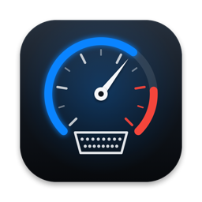
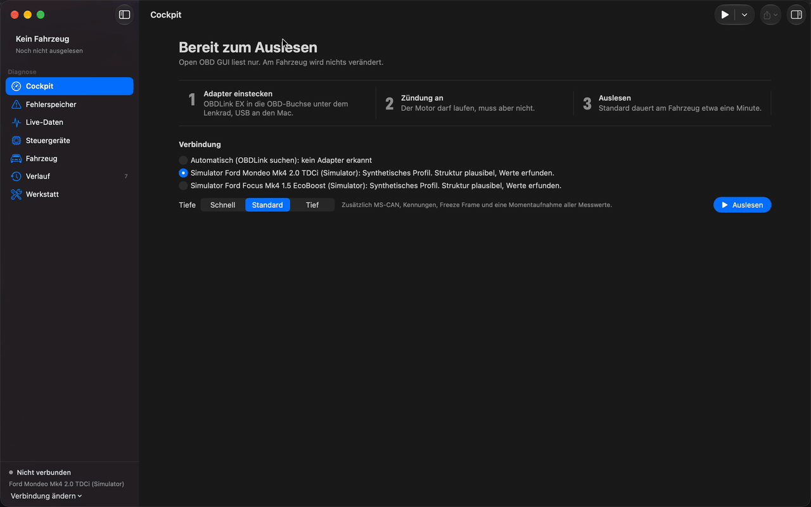
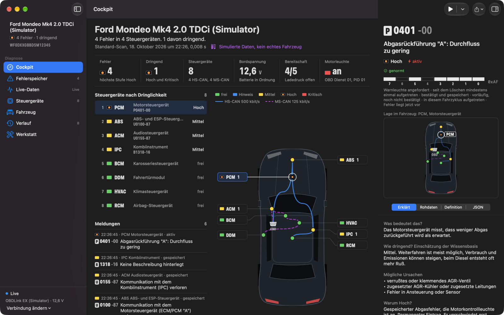
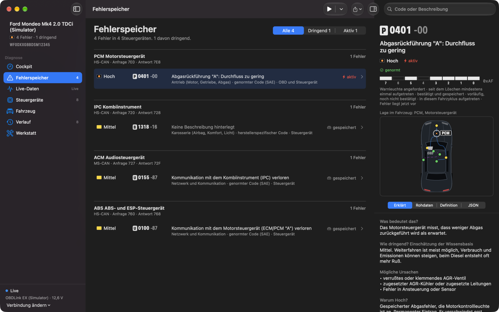
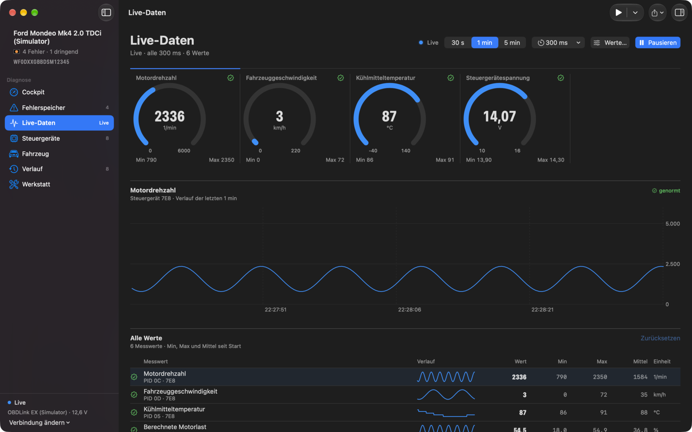
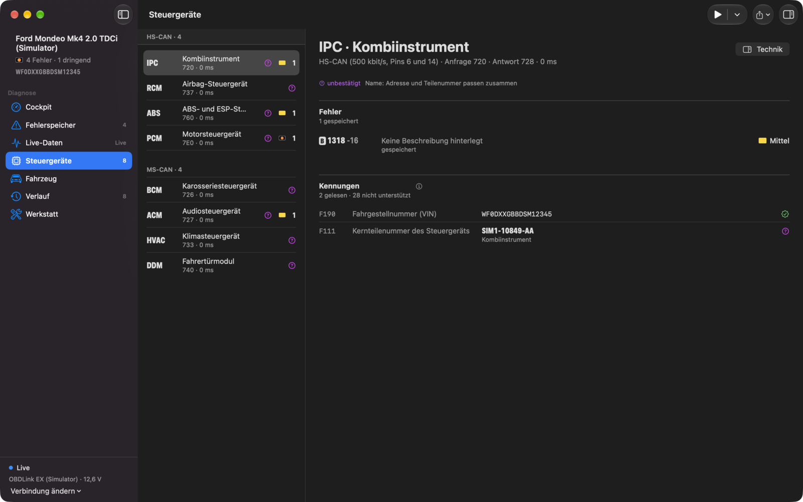
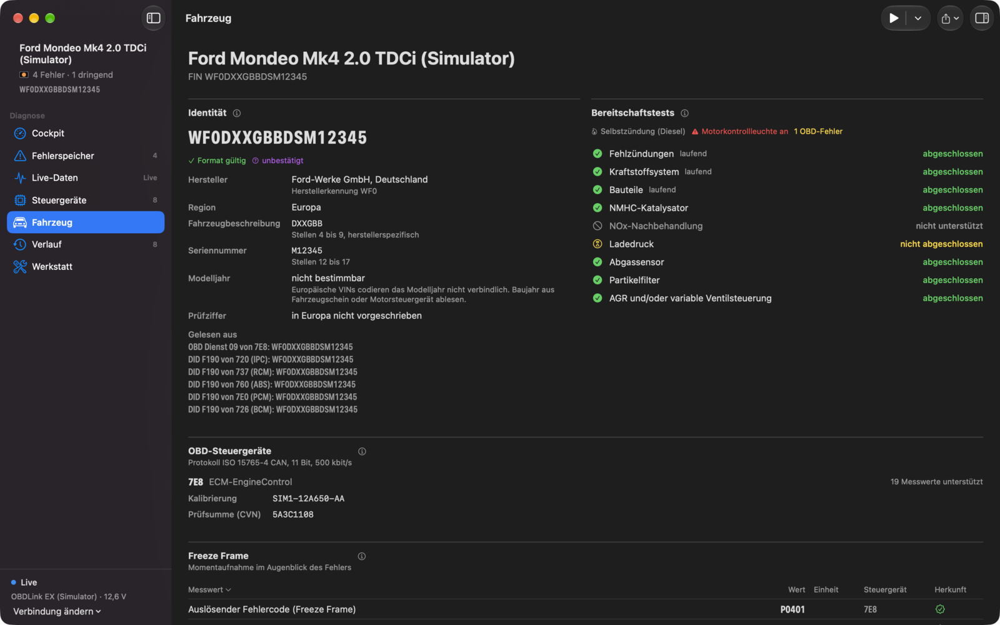
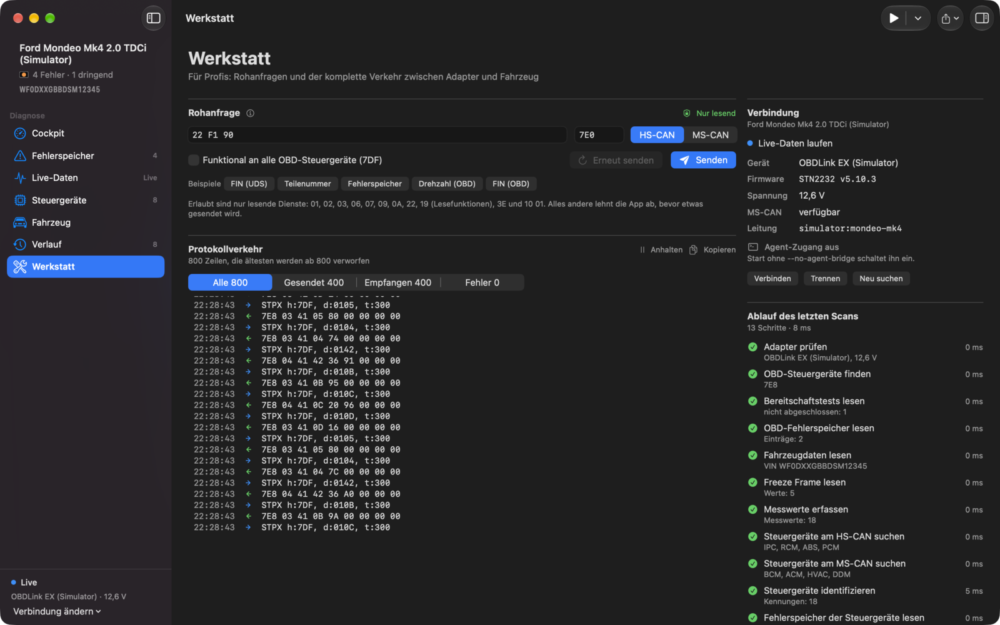
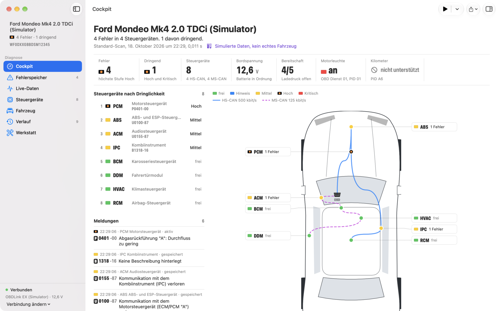

<p align="center">
  
</p>

<h1 align="center">Open OBD GUI</h1>

<p align="center">
  Native macOS diagnostics for Ford vehicles over an OBDLink EX.<br>
  Plug in, read out, understand. Read only by design.
</p>

<p align="center">
  <a href="https://github.com/nicremo/open-obd-gui/releases"></a>
  <a href="https://github.com/nicremo/open-obd-gui/actions/workflows/ci.yml"></a>
  
  
  
  <a href="LICENSE"></a>
</p>

<p align="center">
  
</p>

<p align="center">
  <a href="https://github.com/nicremo/open-obd-gui/releases/latest"><b>Download</b></a> ·
  <a href="#features">Features</a> ·
  <a href="#screenshots">Screenshots</a> ·
  <a href="#installation">Installation</a> ·
  <a href="#command-line">Command line</a> ·
  <a href="#safety">Safety</a> ·
  <a href="CHANGELOG.md">Changelog</a>
</p>

## Why

Most Ford diagnostic software runs on Windows only. Open OBD GUI is a native Mac app built with Swift and SwiftUI: plug the OBDLink EX into the car and the Mac, press **Auslesen** (Read), and see every control module, every trouble code and the live values, explained so that a car enthusiast understands them and with the raw bytes one click away for the workshop.

## Features

- **Full scan in one click.** VIN and vehicle data, all control modules on HS-CAN and MS-CAN, every fault memory (OBD services 03, 07, 0A and UDS 19 02), readiness monitors, freeze frame and a snapshot of all supported values. Three depths: quick, standard, deep.
- **Cockpit with track map.** A top view of the car places each module where it sits, with the HS-CAN and MS-CAN buses drawn from the OBD socket. Urgency is shown as racing flags: clear, info, caution, defect, stop.
- **Trouble codes you can understand.** Grouped by module, ranked by urgency, with what it means, why it is urgent, possible causes, status bits and every source that reported it.
- **Live data.** Gauges, a chart with a selectable time window and a table with min, max and mean for any supported OBD value.
- **Modules.** Part numbers, software and hardware levels and the VIN stored in each module, decoded only where the meaning is certain.
- **Workshop.** Raw requests through the same read-only check, the complete adapter traffic and the timing of every scan step.
- **Technical inspector.** Every value carries its module, service, identifier, request and response bytes, formula, timestamp and confidence.
- **History and export.** Every scan is saved locally and can be reopened or exported as JSON and Markdown.
- **Built-in simulator.** A virtual OBDLink with virtual Ford modules for a Mondeo IV and a Focus IV, so everything works without a car.
- **Command line tool.** `openobd` exposes every capability with stable JSON output, and `--via-app` runs commands inside the running app.

## Screenshots

| Cockpit with inspector | Trouble codes |
| --- | --- |
|  |  |
| **Live data** | **Modules** |
|  |  |
| **Vehicle** | **Workshop** |
|  |  |

Light appearance:



The screenshots show the built-in simulator. The data is synthetic and marked as such in the app.

## Status

Preview. Everything is tested against the built-in simulator (272 automated tests). Validation with a real OBDLink EX on both target vehicles is in progress, so treat results from a real car with care and report what you see.

The interface and the command line messages are German. Code, JSON keys and documentation are English.

| | |
| --- | --- |
| Adapter | OBDLink EX over USB (ELM327 and STN command sets, MS-CAN switching) |
| Target vehicles | Ford Mondeo IV (BA7), Ford Focus IV (C519) |
| Other vehicles | Standard OBD-II (SAE J1979) works on any compliant car, Ford module discovery is Ford specific |
| System | macOS 26 or newer, Apple Silicon |

## Installation

### Download

1. Download `Open-OBD-GUI-<version>-macOS-arm64.zip` from the [latest release](https://github.com/nicremo/open-obd-gui/releases/latest) and unzip it.
2. Move **Open OBD GUI.app** to Applications.
3. The app is signed ad hoc, not notarized. On first launch right-click the app and choose **Open**, or run:

```bash
xattr -dr com.apple.quarantine "/Applications/Open OBD GUI.app"
```

Without a car, start the simulator from the welcome screen or launch with:

```bash
open "/Applications/Open OBD GUI.app" --args --demo mondeo-mk4
```

### Build from source

Requires Xcode 26 or newer. CI builds and tests with Swift 6.3.

```bash
git clone https://github.com/nicremo/open-obd-gui.git
cd open-obd-gui
scripts/build-app.sh
open "dist/Open OBD GUI.app"
```

## Command line

Install `openobd` to `~/.local/bin`:

```bash
scripts/install-cli.sh
```

Or download `openobd-<version>-macos-arm64.tar.gz` from the release, unpack it and keep the binary next to its `.bundle` folder.

```bash
openobd devices                                     # serial devices and how likely each is the adapter
openobd adapter                                     # identity, firmware, battery voltage, MS-CAN
openobd scan --out report.json --markdown report.md # full scan with report files
openobd scan --sim mondeo-mk4 --digest --json       # short report from the simulator
openobd dtc --json                                  # all fault memories
openobd ident --module 726 --bus ms --json          # part numbers and software of one module
openobd live 0C 0D 05 --count 20                    # live values
openobd explain dtc P0401-00                        # explain a trouble code without a car
openobd capabilities --json                         # every command, schema and exit code
```

Every command prints exactly one JSON object with `--json` (schema `openobd.cli/1`), `live` prints one line per value. While the app holds the adapter, add `--via-app` and the command runs inside the app, which shows progress and traffic.

| Exit code | Meaning |
| --- | --- |
| 0 | ok |
| 1 | internal error |
| 2 | usage error or unreadable file |
| 3 | no adapter found |
| 4 | adapter or connection error |
| 5 | vehicle does not answer or rejects the request |
| 6 | denied by the read-only policy |
| 7 | port in use or app busy |
| 8 | app not reachable (`--via-app`) |
| 64 | invalid arguments |
| 130 | cancelled |

## Safety

Open OBD GUI never writes to the vehicle. Every message passes a read-only check right before the serial port, and no code path can bypass it:

| Allowed | Services |
| --- | --- |
| OBD-II | 01, 02, 03, 06, 07, 09, 0A |
| UDS | 22 (read data), 19 01/02/03/04/06/0A (read fault memory), 3E 00/80 (tester present), 10 01 (default session) |

Everything else, including clearing codes, coding, actuator tests, security access and flashing, is rejected before it is sent.

Values whose meaning does not come from a standard or a confirmation on the vehicle are labelled as unconfirmed and never presented as fact:

| Confidence | Meaning |
| --- | --- |
| standard | defined by SAE J1979, SAE J2012 or ISO 14229 |
| verified on vehicle | confirmed on a real car |
| community | public community source, not verified |
| unknown | no meaning on record, only the raw value is shown |

The app makes no network requests. Reports, captures and the VIN stay on your Mac in `~/Library/Application Support/Open OBD GUI`.

## Architecture

A Swift package with strict concurrency. The app and the command line tool share one diagnostic engine.

| Module | Responsibility |
| --- | --- |
| `OBDCore` | Standards as code: ISO-TP, OBD-II (SAE J1979), UDS (ISO 14229), trouble code structure, read-only policy |
| `AdapterKit` | Serial port, device discovery, ELM327 and STN protocol, command policy, capture and replay |
| `FordKnowledge` | Knowledge base with source and confidence for every entry |
| `VehicleSim` | Virtual OBDLink with virtual Ford modules |
| `DiagnosticEngine` | Session, scan pipeline, live data, reports, local bridge to the app |
| `CLIKit`, `openobd` | Command line tool |
| `OpenOBDApp` | SwiftUI app |

```bash
swift build
swift test
```

## Contributing

Reports from real vehicles are the most valuable contribution right now. See [CONTRIBUTING.md](CONTRIBUTING.md) and please remove your VIN before sharing captures or reports.

## Disclaimer

Open OBD GUI is an independent project. It is not affiliated with, endorsed by or connected to Ford Motor Company or OBD Solutions (OBDLink). All product names and trademarks belong to their owners. Use at your own risk, the software comes without warranty.

## License

[MIT](LICENSE)
